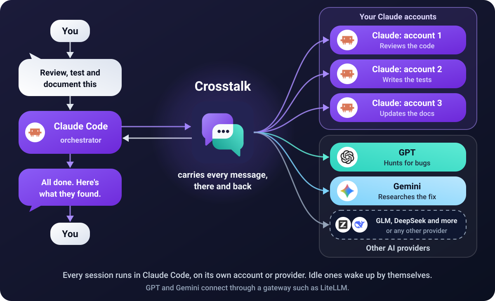
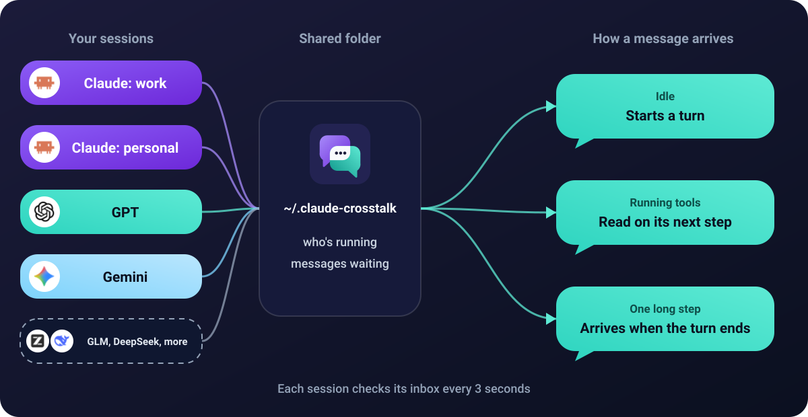

<p align="center">
  
</p>

<p align="center">
  <a href="#install"></a>
  <a href="#what-it-works-with"></a>
  <a href="LICENSE"></a>
</p>

<p align="center">
  <b>Tell one session what you want. It hands the work to your other sessions, and they reply when they're done.</b><br>
  Idle sessions wake up by themselves, on any account and any provider.
</p>

<p align="center">
  
</p>

<p align="center">
  <a href="#install">Install</a> ·
  <a href="#use-it">Use it</a> ·
  <a href="#opening-sessions">Opening sessions</a> ·
  <a href="#multiple-claude-accounts">Multiple accounts</a> ·
  <a href="#what-it-works-with">Providers</a> ·
  <a href="#usage-guard">Usage guard</a> ·
  <a href="#handing-work-to-github-copilot-cli">Copilot</a> ·
  <a href="#costs-and-safety">Costs and safety</a>
</p>

## Install

**1. Install it.** At the prompt of a terminal session, then restart that session:

```text
/plugin install crosstalk --marketplace svumo/claude-crosstalk
```

**2. Connect your other profiles.** Skip this if you only have one.

```text
/crosstalk setup
```

It lists the profiles it found and what it would do, without changing anything. If that looks right, run `/crosstalk setup yes`. That installs Crosstalk on each profile and gives any profile with no way to start it a short command, such as `claude-work`. Open a new terminal, start your sessions, and they can reach each other.

No second profile yet? `/crosstalk add work` makes one. Run `claude-work` in a new terminal and log in.

<details>
<summary><b>From a shell, or the desktop app</b></summary>

From a shell: `claude plugin install crosstalk --marketplace svumo/claude-crosstalk`

In the desktop app, where `/plugin` does not run: click **+** next to the prompt box, then **Plugins**, **Add marketplace** with `svumo/claude-crosstalk`, then **Add plugin**.

</details>

## Use it

Just ask, in plain words:

- "List the other sessions."
- "Ask the session on my work account to review my changes."
- "Open a session on my personal account and have it write the tests."

Every message that arrives is shown in the transcript as `Crosstalk ← sender`, so you don't have to ask whether anyone replied.

| Command | What it does |
|---|---|
| `/crosstalk` | This session's name and address, and who it can reach |
| `/crosstalk <profile> [message]` | Opens a session on that profile in this folder, and sends it your message once it's up |
| `/crosstalk to <who> <message>` | Sends a message to a running session, without a model turn |
| `/crosstalk where [auto\|app\|panel\|editor\|window]` | Shows or sets where `open` puts a new session (see [Opening sessions](#opening-sessions)) |
| `/crosstalk setup [yes]` | Connects your profiles, the editor helper and the desktop-app notifications |
| `/crosstalk add <name>` | Makes a new profile, ready to log in to |
| `/crosstalk usage`, `move <profile>` | The [usage guard](#usage-guard) |
| `/crosstalk off` / `on` | Pauses and resumes it. Messages wait while it's off |
| `/crosstalk help` | Every command, including `editor` and `launch` |

The model has the same through its tools: `list`, `send`, `open`, and `crosstalk`, which runs any `/crosstalk` command line.

### Session names and addresses

```
You are Review the PR (work/review-the-pr-1a2b).
Also running:
Plan the next release (personal/plan-the-next-release-730f, folder C:\code\my-app)
```

**The name** is the session's title: its title in the desktop app's sidebar, or the one Claude Code gave it (or you set with `/rename`) in a terminal. Titles change as a session runs, so each session checks its own about every 15 seconds.

**The address** is `profile/title-xxxx`. Until a session has a title it goes by its folder (`work/my-app-1a2b`), and it keeps answering to that address afterwards. To send a message, use the address, the profile alone when it has one session running, or the title when only one session has it.

## Opening sessions

`/crosstalk open` (or `/crosstalk <profile>`) starts a session where you already are, in the same folder:

| You're in | It opens |
|---|---|
| The Claude desktop app on Windows | A Code session in **that profile's own app window**, with the folder and your message filled in and sent. `default` is the main window. See the [desktop app guide](docs/desktop-app.md) to set the windows up |
| The desktop app on macOS or Linux, or with `--in panel` | A tab of the app's Terminal panel. The app asks you to approve the command |
| A VS Code or VSCodium terminal | A terminal tab in that editor. The first time, `open` installs a small helper extension and asks you to reload the window once |
| Windows Terminal | A new tab of the window you're in |
| Anywhere else | A new terminal window: Terminal on macOS; on Linux a tmux window inside tmux, else the first desktop terminal found |

`/crosstalk where` shows what it will do from this session and why, and `/crosstalk where window` (or `--in window` on one `open`) always uses a separate window.

- **Which profile.** A profile you name wins, said any way people say it (`work`, `claude-work`, "the work app"). With none, it opens this session's own profile. `/crosstalk open window` opens the account of the desktop-app window this session runs in.
- **Model and mode.** `/crosstalk open work --model sonnet --mode plan review this` sets the new session's model and permission mode. `bypassPermissions` isn't offered (build choice), so a model can't start an unsupervised session. To always start a profile that way, save it in its launch command.
- **Launch command.** The default is `claude-<profile>`. If you start a profile another way, tell Crosstalk once: `/crosstalk launch zai claude zai`.
- **Trust.** A profile that hasn't opened the folder would stop at "Is this a project you trust?" with nobody to answer, so `open` marks the folder trusted in that profile's `.claude.json` first (build choice: you're already working there). Nothing else in the file changes.
- **Which editor.** Crosstalk tells VS Code and VSCodium apart from the terminal the session runs in. Pin one with `/crosstalk editor code` or `codium`. The editor settings `crosstalkTerminal.location` (`right`, `beside`, `split`, `bottom`) and `crosstalkTerminal.focus` set where the tab goes.

Crosstalk carries the messages; it doesn't plan the work. Whichever session you ask does the orchestrating.

## Multiple Claude accounts

Claude Code's built-in messaging only reaches sessions on the same profile. Crosstalk connects profiles through a folder they can all read. A *profile* is a separate Claude Code config folder with its own login, so each account gets its own.

`/crosstalk setup` finds profiles in this session's own config folder, `.claude` and `.claude-*` folders in your home folder, any `CLAUDE_CONFIG_DIR` in your shell profile (`.bashrc`, `.zshrc`, PowerShell) and folders you've added. Names come from the folder: `~/.claude` is `default`, `~/.claude-work` is `work`. Correct the list with:

| Command | What it does |
|---|---|
| `/crosstalk setup add <folder> [name]` | Adds a profile it missed. Quote a path with spaces |
| `/crosstalk setup skip <name>` | Leaves one out, such as an old backup |
| `/crosstalk setup name <name> <new name>` | Renames a profile |

<details>
<summary><b>What setup changes on your computer</b></summary>

- It runs `claude plugin install` for each profile that needs it.
- It adds shortcuts to your shell profile inside a marked `crosstalk shortcuts` block, and saves the file as it was beside it (`.crosstalk-backup`). A profile you already start your own way gets no shortcut.
- It reads only folder paths from your shell files, and only the provider's host name from a profile's settings. It never copies or shows keys.

By hand: `CLAUDE_CONFIG_DIR=~/.claude-work claude plugin install crosstalk --marketplace svumo/claude-crosstalk` (in PowerShell, set `$env:CLAUDE_CONFIG_DIR` first).

</details>

**In the desktop app** each account can have its own window, with notifications that open the right one: see the [desktop app guide](docs/desktop-app.md).

## What it works with

**Any AI provider you can point Claude Code at**: anything with an Anthropic-compatible endpoint, or any other model through a gateway such as LiteLLM. The model has to support tool calls, since that's how a session sends a message.

| Provider | How it connects | Status |
|---|---|---|
| Claude, on one or many accounts | Directly | Tested |
| GPT, Gemini | Through a gateway such as LiteLLM | Should work, not tested |
| GLM, DeepSeek and more | Their Anthropic-compatible endpoint, or a gateway | GLM tested |

<details>
<summary><b>Adding a provider</b></summary>

Make a profile with `/crosstalk add glm`, then put the provider's details in `~/.claude-glm/settings.json`:

```json
{
  "env": {
    "ANTHROPIC_BASE_URL": "https://api.z.ai/api/anthropic",
    "ANTHROPIC_AUTH_TOKEN": "your key"
  }
}
```

That's Z.ai's endpoint for GLM; use your provider's or gateway's address instead. Start it with `claude-glm`, and `/crosstalk setup` shows the provider beside the name.

</details>

## How it works

<p align="center">
  
</p>

Each session records that it's running in `~/.claude-crosstalk` and checks its inbox every 3 seconds. When a message arrives:

- **If the session is idle,** the message starts a turn.
- **If it's working,** the model reads it on its next step, once the current tool calls finish.
- **If it's in one long step with no tools,** it arrives when that turn ends.

## Usage guard

At 93% of any usage limit (the 5-hour or weekly window, or a gateway spend limit), every session on that account stops before it hits the limit mid-task. It never triggers on an API key or a provider that reports no limits. For each session, Crosstalk:

1. Holds its wake-ups, so messages wait in its inbox.
2. Stops the turn it's running.
3. Writes a handoff to `handoffs/` in the shared folder: the folder, the account, the transcript path, and a digest cut from the transcript (no model call, so it costs no usage). A session nothing was typed in gets none.
4. Offers once to move to the profile with the lowest known usage. Accept, and that profile opens in the same folder, reads the handoff and carries on. Any other profile can be typed under Other.

The first session to see it tells the rest through `usage/<profile>.json`, so idle sessions stop too.

| Command | What it does |
|---|---|
| `/crosstalk usage` | Each account's last known usage, and where this session stops and why |
| `/crosstalk usage <1-100\|off>` | Where every session on an account stops. Default: 93 |
| `/crosstalk usage here <1-100\|off>` | This session alone stops earlier, such as 80 |
| `/crosstalk usage large <1-100\|off> [context %]` | Where a session with a full context stops. Default: 85 once it's 60% full |
| `/crosstalk move <profile>` | Hands this session to another account now |

A session moved because its account ran out is told it owns the work alone and should ask you, not the paused session, if it gets stuck. One moved with usage to spare reports back when it's done or blocked. `list` and `send` mark sessions that are paused for usage.

## Handing work to GitHub Copilot CLI

`/crosstalk-gh <task>` hands a task to GitHub Copilot CLI. Copilot works in its own git worktree and branch, cut from the commit you're on, so your checkout isn't touched. The result comes back as a Crosstalk message with a diff stat, the branch and the commands to review, merge or discard it.

- Copilot asks before it writes, runs a command or uses the network. Requests pop up in Claude Code's question dialog. The `ask`, `auto` and `bypass` modes set how much goes through without asking.
- `/crosstalk-gh open` watches a task live in a terminal and answers its requests with a key.
- A `gh` ring among the skins meters shows the account's monthly Copilot AI credits.
- Claude can run any `/crosstalk-gh` command itself, through the `crosstalk_gh` tool.

It needs Node.js 22.18 or newer and Copilot signed in by you (`copilot login`); then run `/crosstalk-gh setup` once. Crosstalk handles no tokens. The full guide is [docs/copilot.md](docs/copilot.md).

## Costs and safety

- **Wake-ups use tokens.** Each message that wakes a session uses that profile's usage. After 25 wake-ups in a row, new messages wait until you type, so two sessions can't reply to each other forever (`CLAUDE_CROSSTALK_WAKE_LIMIT`).
- **The usage guard costs nothing** by default. With `usageCompact: true` in `setup.json` it has the model write the summary instead, one request on the nearly spent account.
- **Messages are plain text on disk,** so don't send passwords or keys.
- **Messages aren't your approval.** Any program on your computer can write to the folder, so each message is presented to the model as information from another session, and it's told to ask you before anything that needs your approval. That's an instruction, not a hard block, so keep your normal permission settings on.

## Limits

- Sessions must be on the same computer, and messages take a few seconds to arrive.
- Messages are capped at 20,000 characters. For anything bigger, write a file and send the path.
- Records older than 7 days are cleared, which needs `node` on your PATH.

## Troubleshooting

| What you see | What to do |
|---|---|
| `claude-work` isn't recognised | Open a new terminal; shortcuts load when one starts. In PowerShell, setup says if scripts need allowing |
| A session isn't listed | Restart it: sessions load the plugin only when they start. `/crosstalk setup` shows whether a profile has it |
| A profile isn't in `/crosstalk setup` | `/crosstalk setup add <folder>` |
| "could be several sessions" | That profile or title has more than one session running: use the whole address |
| A session shows its address, not its name | It has no title yet; Crosstalk picks it up within about 15 seconds. For a desktop-app session, set `CLAUDE_CROSSTALK_APP_DATA` to that app copy's data folder |
| A message didn't wake a session | Run `/crosstalk` there. It may be off, or at its wake-up limit, which clears when you type |
| A provider can't send messages | Its model may not support tool calls |
| `open` went somewhere unexpected | `/crosstalk where` says where it goes from this session and why |
| `open` says no session showed up | Look in the new terminal. Check the launch command with `/crosstalk launch <profile>` |
| On Linux, `open` can't find a terminal | Set `CLAUDE_CROSSTALK_TERMINAL`. Desktop terminals need `DISPLAY` or `WAYLAND_DISPLAY` |
| On macOS, `open` asks to control Terminal | Allow it once |
| Install says "Host key verification failed" on Windows | The profile's folder path may be too long (installs failed from 140 characters): use a shorter one |

## Settings

`/crosstalk where`, `editor`, `launch` and `usage` save to `setup.json` in the shared folder, so every profile uses them. Environment variables, set before a session starts, win over it:

| Variable | What it does | Default |
|---|---|---|
| `CLAUDE_CROSSTALK_NAME` | This session's profile name | From the folder |
| `CLAUDE_CROSSTALK_DIR` | The shared folder. Set the same on every profile | `~/.claude-crosstalk` |
| `CLAUDE_CROSSTALK_WAKE_LIMIT` | Wake-ups in a row before messages wait for you | 25 |
| `CLAUDE_CROSSTALK_OPEN_IN` | Where `open` starts a session: `auto`, `app`, `panel`, `editor` or `window` | `auto` |
| `CLAUDE_CROSSTALK_EDITOR` | The editor for new terminal tabs: `code` or `codium` | Spotted |
| `CLAUDE_CROSSTALK_TERMINAL` | On Linux, the terminal `open` tries first, such as `kitty` or `tmux` | The first found |
| `CLAUDE_CROSSTALK_WINDOW` | The desktop-app window this session counts as running in (Windows) | Found from its parent processes |
| `CLAUDE_CROSSTALK_APP_DATA` | The desktop app's data folder, if a session's title isn't found | The app copy that started it |
| `CLAUDE_CROSSTALK_USAGE_STOP` | Where sessions stop near a usage limit: 1-100 or `off` | 93 |

Copilot's settings are in [docs/copilot.md](docs/copilot.md).

## Tested on

Windows 11 (PowerShell 7 and Git Bash) and the Claude desktop app on Windows. CI runs the tests on macOS, Ubuntu and Windows, and checks `open` for real on macOS (Terminal) and Linux (tmux, xterm). A full session between two logged-in profiles has only been run on Windows, so reports from macOS and Linux are welcome.

## Accounts and terms

Crosstalk shares no logins or usage limits: each profile keeps its own. If you use several accounts or providers, their terms still apply.

This is an independent project, not affiliated with or endorsed by Anthropic, OpenAI, Google, GitHub, Z.ai, DeepSeek or any other AI provider. Their names belong to them and are used only to show what Crosstalk connects to.

## Development

The plugin has no dependencies and no build step. The TypeScript tooling is for the Copilot sidecar and the type check.

```bash
npm ci                    # dev tools only
npm run typecheck         # tsc --noEmit
npm run test:sidecar      # Copilot sidecar tests (node --test)
claude plugin test .      # plugin tests
claude plugin validate .
claude --plugin-dir .     # run it from this folder
```

`node scripts/install-local.mjs` (`--dry-run` first) updates every profile on this computer from what you've committed. Claude Code only loads new code when the version in `.claude-plugin/plugin.json` changes, so bump it, then restart your sessions. To try `/crosstalk setup` without touching your real files, set `CLAUDE_CROSSTALK_HOME` to an empty folder.

## Licence

[MIT](LICENSE)
