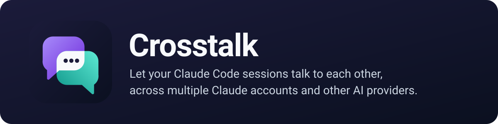

<p align="center">
  
</p>

<p align="center">
  <a href="#install"></a>
  <a href="#what-it-works-with"></a>
  <a href="LICENSE"></a>
</p>

<p align="center">
  <b>Tell one session what you want. It hands the work to your other sessions, and they reply when they're done.</b><br>
  Idle sessions wake up by themselves, on any account and any provider.
</p>

<p align="center">
  
</p>

<p align="center">
  <a href="#install">Install</a> ·
  <a href="#use-it">Use it</a> ·
  <a href="#multiple-claude-accounts">Multiple accounts</a> ·
  <a href="#what-it-works-with">Providers</a> ·
  <a href="#how-it-works">How it works</a> ·
  <a href="#costs-and-safety">Costs and safety</a>
</p>

## Install

**1. Install it.** At the prompt of a terminal session, then restart that session:

```text
/plugin install crosstalk --marketplace svumo/claude-crosstalk
```

**2. Connect your other profiles.** Skip this if you only have one.

```text
/crosstalk setup
```

It lists the profiles it found and what it would do, without changing anything. If that looks right:

```text
/crosstalk setup yes
```

That installs Crosstalk on each profile and gives any profile with no way to start it a short command, such as `claude-work`. Open a new terminal, start your sessions, and they can reach each other.

Don't have a second profile yet? `/crosstalk add work` makes one. Run `claude-work` in a new terminal and log in.

<details>
<summary><b>From a shell, or the desktop app</b></summary>

From a shell:

```bash
claude plugin install crosstalk --marketplace svumo/claude-crosstalk
```

In the desktop app, where `/plugin` does not run: click **+** next to the prompt box, then **Plugins**, **Add marketplace** with `svumo/claude-crosstalk`, then **Add plugin**.

</details>

## Use it

Just ask, in plain words:

- "List the other sessions."
- "Ask the session on my second account to review my changes."
- "Send work a message saying the build is fixed."

| Command | What it does |
|---|---|
| `/crosstalk` | Shows this session's name and address, and who it can reach |
| `/crosstalk off` | Pauses it: messages wait |
| `/crosstalk on` | Turns it back on |
| `/crosstalk setup` | Shows your profiles and what setup would do. Changes nothing |
| `/crosstalk setup yes` | Does it |
| `/crosstalk add <name>` | Makes a new profile, ready to log in to |
| `/crosstalk open [profile] [--model m] [--mode p] [message]` | Starts a session on that profile in a new terminal, in this folder, and sends it your message once it's up. With no profile, it uses this session's own. `window` uses the account of the desktop-app window this session runs in. `--model` and `--mode` set its model and permission mode |
| `/crosstalk open-in auto\|app\|vscode\|window` | Where `open` starts it. `auto` is a tab in the Claude desktop app's Terminal panel when you're in the app, an editor tab when you're in VS Code or VSCodium, else a new window. On its own, `/crosstalk open-in` says what `open` will do from this session and why |
| `/crosstalk editor auto\|code\|codium` | Which editor the tab opens in. `auto` spots VS Code or VSCodium from the terminal this session runs in |
| `/crosstalk launch <profile> <command>` | The command that starts a profile, such as `claude zai`. Default: `claude-<profile>` |
| `/crosstalk usage` | Each account's last known usage, and where this session stops and why (see Usage guard) |
| `/crosstalk usage <1-100\|off>` | Where every session on an account stops. Default: 93 |
| `/crosstalk usage here <1-100\|off>` | This session alone stops earlier, such as 80 for a big session |
| `/crosstalk usage large <1-100\|off> [context %]` | Where a session with a full context stops. Default: 85 once its context is 60% full |
| `/crosstalk move <profile>` | Hands this session to another account now: compacts it, writes a handoff and opens the profile on it |

Every message that arrives is also shown to you in the transcript, as `Crosstalk ← sender`, so you don't have to ask whether anyone replied.

### In the Claude desktop app

Crosstalk works in the desktop app's Code tab the same way as in a terminal. The app signs in to one account at a time, so there are two ways to add sessions on your other accounts:

- **A tab in the app's Terminal panel (no setup).** From a session in the app, `/crosstalk open mikey` (or "open a session on my mikey account and ask it to review this") starts that profile in a new tab of the app's **Terminal panel**. It runs inside the app on that profile's own login and subscription. Crosstalk uses the app's own Terminal tool, and the app asks you to approve the command. The panel's shell is your PowerShell (or login shell) with your profile loaded, so launch commands such as `claude mikey` work there. `/crosstalk open-in window` goes back to a separate terminal window. Ask for "a different session" without naming an account, and it stays on the account you're in. `list` shows which app window each session runs in, and `/crosstalk open window` opens that window's account.
- **A second app window per account (Windows, one-time setup).** Scripts in [`app-windows/`](app-windows/) run another copy of the app signed in to another account, with its own sidebar and sessions. They can start a session in that window with the folder and prompt filled in, and a `move-chat` skill moves a whole chat across. Run `app-windows\install.ps1` once, then sign in to the new window with the emailed code.

The [desktop app guide](docs/desktop-app.md) covers both: setup, sign-in, limits and troubleshooting.

### Session names and addresses

Each session is listed by the name you see for it, with its address:

```
You are Crosstalk: name sessions by their app title (default/crosstalk-name-sessions-by-their-0850).
Also running:
Claude Fuuk for next task (default/claude-fuuk-for-next-task-730f, folder C:\code\cc-consent-forms)
Review the PR (work/review-the-pr-1a2b, folder C:\code\my-app)
```

**The name** is the session's title. A session in the Claude desktop app goes by its title in the app's sidebar. Crosstalk reads it from the app's own record of the session, in the data folder of the app copy that started it, so a second copy of the app (started with `--user-data-dir`, say for another account) works too. A session in a terminal goes by the title Claude Code gave it, or the one you set with `/rename`. Titles change as a session runs (the app names a session after its first message), so each session checks its own about every 15 seconds. A session with no title yet is listed by its address alone. Messages show the sender's name too: `Crosstalk ← Claude Fuuk for next task (default/claude-fuuk-for-next-task-730f)`.

**The address** is made from the title, `profile/title-xxxx`, such as `work/review-the-pr-1a2b`, so it reads as the name you see. Until a session has a title it goes by its folder, `work/my-app-1a2b`, and it keeps answering to that folder address after its title comes, so a message sent to it still arrives. To send a message, use the address, the profile name alone when that profile has one session running, or the session's title when only one session has it ("send Claude Fuuk for next task a message").

### Opening a session in VS Code or VSCodium

`/crosstalk open` opens a new terminal tab in your VS Code or VSCodium window, and the model can do the same: "Open a GLM session and ask it to review this file." This needs a small helper extension, because nothing outside the editor can open a terminal inside it. Install it once, in the editor you use:

```bash
code --install-extension <the plugin's folder>/vscode/crosstalk-terminal-0.3.0.vsix     # VS Code
codium --install-extension <the plugin's folder>/vscode/crosstalk-terminal-0.3.0.vsix   # VSCodium
```

`/crosstalk open-in` prints this command with the real folder filled in when the helper is missing.

**Which editor it uses.** Each session works it out from the terminal it runs in, not from which editors are open. VS Code and VSCodium both mark their terminals as VS Code's, so Crosstalk tells them apart by the editor's own program path, which every VS Code-family terminal carries. A session in VSCodium opens the new tab in VSCodium, one in VS Code opens it in VS Code, and one in any other terminal opens a new window. To pin it, use `/crosstalk editor code` or `/crosstalk editor codium` (`auto` goes back to spotting it), or set `CLAUDE_CROSSTALK_EDITOR`. Run `/crosstalk open-in` on its own to see what it decided:

```
New sessions open in: auto. Choices: auto, app, vscode, window.
From this session, open starts a VSCodium terminal tab.
Editor: VSCodium (spotted from this session's terminal). Helper: installed.
```

Or build it from `vscode/` with `npx @vscode/vsce package`. The helper only runs commands that start Claude Code, so a link from anywhere else can't run anything else through it. Without the helper, or outside an editor terminal, `open` starts a new terminal window. On Windows that's Windows Terminal. On macOS it's Terminal. On Linux it's a new tmux window when you're inside tmux, otherwise the first desktop terminal it finds (`CLAUDE_CROSSTALK_TERMINAL` picks one). The new shell runs your startup files, so `claude-<profile>` shortcuts work there. The first time on macOS, it asks whether the app you run Claude Code in may control Terminal. Say yes; Crosstalk waits up to two minutes for the answer.

If you start a profile some other way than `claude-<profile>`, tell Crosstalk once: `/crosstalk launch zai claude zai`.

You can set the new session's model and permission mode, as in `/crosstalk open mikey --model sonnet --mode plan review this`. The model can do the same with the `open` tool:

| `open` parameter | What it does |
|---|---|
| `profile` | The profile to start, as `/crosstalk` names them. Required |
| `message` | A first message, sent once the session is up |
| `model` | Adds `--model`, such as `sonnet` or `claude-sonnet-5-5`. One plain word only, so `opus[1m]` isn't accepted |
| `permissionMode` | Adds `--permission-mode`: `default`, `manual`, `acceptEdits`, `plan`, `auto` or `dontAsk`, in any case |

Left out, the session uses the profile's own launch command. `bypassPermissions` isn't offered (build choice), so a model can't start a session that runs unsupervised on its own. If you want a profile to always start that way, put it in its saved launch command: `/crosstalk launch mikey claude-mikey --permission-mode bypassPermissions`.

**The folder is trusted for you.** A profile that hasn't opened this folder before would stop at "Is this a project you trust?", with nobody there to answer it. So before it starts, `open` marks the folder as trusted in that profile's `.claude.json`, the same record Claude Code writes when you answer yes. This is a build choice: the session doing the opening is already running in this folder, so you have trusted it on that profile, and Crosstalk only carries that trust over to a session you asked for in the same folder. Every other setting in the file is left as it was. A session already running on that profile can write over the change with its own copy, so Crosstalk reads the file back and marks it again if it has to. If the file can't be updated, the session still opens, and Crosstalk tells you it may stop at the trust screen.

By default the new session opens as a tab to the right of your terminal tabs at the top, and takes focus. Two editor settings (the same in VS Code and VSCodium) change that. You don't need to reload after changing them:

| Setting | Choices | Default |
|---|---|---|
| `crosstalkTerminal.location` | `right`: a new tab to the right. `beside`: a new column beside this one. `split`: split with the active terminal. `bottom`: the bottom terminal panel | `right` |
| `crosstalkTerminal.focus` | `true`: jump to the new tab. `false`: stay where you are | `true` |

After installing or updating the helper, reload the editor window (**Developer: Reload Window**) so the new version loads. Restarting only the extension host doesn't load it.

Crosstalk carries the messages; it doesn't plan the work. Whichever session you ask does the orchestrating, so you can make any session the lead.

## Multiple Claude accounts

Claude Code's built-in messaging only reaches sessions on the same profile, because each profile keeps its own list of sessions. A session on one account can't see a session on another. Crosstalk connects them through a folder they can all read.

A *profile* is a separate Claude Code config folder with its own login, so each account gets its own.

**Everyone sets these up differently, so setup looks in several places:**

- this session's own profile
- `.claude` and `.claude-*` folders in your home folder
- any `CLAUDE_CONFIG_DIR` in your PowerShell profile, `.bashrc`, `.zshrc` and similar, which is how it finds folders kept somewhere else
- folders you've told it about

If you already start a profile your own way, it leaves that alone and adds no shortcut. If the list isn't right, correct it:

| Command | What it does |
|---|---|
| `/crosstalk setup add <folder> [name]` | Adds a profile it missed. Put a path with spaces in double quotes |
| `/crosstalk setup skip <name>` | Leaves one out, such as an old backup |
| `/crosstalk setup name <name> <new name>` | Changes a profile's name |

**Names** come from the folder unless you change them: `~/.claude` is `default`, `~/.claude-work` is `work`, and any other folder goes by its own name.

<details>
<summary><b>What setup changes on your computer</b></summary>

- It runs `claude plugin install` for each profile that needs it.
- It adds shortcuts to your PowerShell profile, and your `.bashrc` or `.zshrc`, inside a marked `crosstalk shortcuts` block. Running it again updates that block and nothing else. The file as it was is saved beside it, ending `.crosstalk-backup`.
- From your shell files it only takes folder paths, and from a profile's settings only the provider's host name. It doesn't copy or show keys.

If PowerShell isn't allowed to run its profile, setup tells you the command to allow it and doesn't write the file. If an install fails, it gives you the line to run yourself.

</details>

<details>
<summary><b>Doing it by hand</b></summary>

```bash
# macOS or Linux
CLAUDE_CONFIG_DIR=~/.claude-work claude plugin install crosstalk --marketplace svumo/claude-crosstalk
CLAUDE_CONFIG_DIR=~/.claude-work claude
```

```powershell
# Windows PowerShell
$env:CLAUDE_CONFIG_DIR = "$HOME\.claude-work"
claude plugin install crosstalk --marketplace svumo/claude-crosstalk
claude
```

</details>

**In the desktop app**, each account can have its own window: see the [desktop app guide](docs/desktop-app.md).

## What it works with

**Any AI provider you can point Claude Code at.** Claude Code speaks Anthropic's API format, so that means anything with an Anthropic-compatible endpoint, or any other model through a translating gateway such as LiteLLM. The model has to support tool calls, because that's how a session sends a message.

| Provider | How it connects | Status |
|---|---|---|
| Claude, on one or many accounts | Directly | Tested |
| GPT | Through a gateway such as LiteLLM | Should work, not tested |
| Gemini | Through a gateway such as LiteLLM | Should work, not tested |
| Others: GLM, DeepSeek and more | Their Anthropic-compatible endpoint, or a gateway | GLM tested, the rest should work |

Crosstalk runs on your computer, not in the model, so it doesn't care which model is on the other end. If you try a provider that isn't marked as tested, reports are welcome.

<details>
<summary><b>Adding a provider</b></summary>

Make a profile for it with `/crosstalk add glm`, then put the provider's details in that profile's `settings.json`, here `~/.claude-glm/settings.json`:

```json
{
  "env": {
    "ANTHROPIC_BASE_URL": "https://api.z.ai/api/anthropic",
    "ANTHROPIC_AUTH_TOKEN": "your key"
  }
}
```

That's Z.ai's endpoint for GLM. For another provider, use its own Anthropic-compatible address, or your gateway's. Start it with `claude-glm`, then run `/crosstalk setup` from any profile: the provider shows beside the name.

</details>

## How it works

<p align="center">
  
</p>

Each session records that it's running and checks its own inbox. When a message arrives:

- **If the session is idle,** the message starts a turn.
- **If it's working,** the model reads the message on its next step, once the current tool calls finish.
- **If it's in one long step with no tools,** the message arrives when that turn ends.

## Usage guard

When an account gets close to its usage limit, every session on it would otherwise keep going until it hits the limit mid-task. Crosstalk stops them first, at 93% of any limit (the 5-hour or weekly window, or a gateway spend limit). It never triggers on an API key or a non-Claude provider, since those report no limits.

For each session on that account, Crosstalk:

1. Holds its wake-ups, so no message starts a turn while it's over the limit. Messages wait in its inbox.
2. Stops the turn it's running, if any.
3. Writes `handoffs/<date>-<address>.md` in the shared folder, with the folder, the account, the transcript path and a digest cut from the transcript on disk (the first request, the latest few, and the last assistant message). No model call is made, so it costs no usage. Set `usageCompact: true` in `setup.json` to have the model write a `/compact`-style summary instead. A desktop notification goes out too. A session nothing was typed in gets no handoff.
4. Asks once whether to move the session to the other profile with the lowest known usage, or Not now. You can type any other profile name under Other. If you accept, that profile opens in the same folder (as a new tab of your Windows Terminal window when you are in one) and is told to read the handoff and carry on.

The first session to see 93% writes `usage/<profile>.json` to the shared folder. Every other session on that profile, or on the same account under another profile name, checks for it every 3 seconds, so idle sessions stop too. Each session acts once per window. "Not now" holds until the window resets.

**Moving big sessions earlier.** A session with a lot of context needs room to compact and hand off, so it stops before the rest:

- A session whose context is 60% full or more stops at 85%. Change it with `/crosstalk usage large <n> [context %]`, or turn it off with `off`.
- `/crosstalk usage here 80` stops this one session at 80%. It's kept in the session's record, so it survives a reload.
- `/crosstalk move <profile>` moves a session right away, at any usage.

A session that stops early stops alone. It doesn't tell the rest of the account to stop.

**Who reports back to whom.** A moved session is told whether to report back:

- If the old session stopped near its limit (the guard's own move, or `/crosstalk move` while over), the new one is told it owns the work alone. It shouldn't message the old one, which is paused and may not have enough usage left to answer, and it should ask you in its own chat if it gets stuck.
- If the old session still has plenty of usage (a `/crosstalk move` well under the limit), the new one messages it only if it gets blocked or when it's done.
- The `send` tool still delivers a message to a session that's paused for usage. Its reply says that session won't answer before its limit resets and suggests asking you instead. `list` marks such sessions "paused near its usage limit", and its first line shows this session's own usage. The `move-chat` skill uses that line to choose the same wording.

## Costs and safety

- **The usage guard costs nothing by default.** The handoff is cut from the transcript without a model call. Only with `usageCompact: true` does it make one summary request on the nearly spent account.

- **Wake-ups use tokens.** Each message that wakes a session uses that profile's tokens or usage. After 25 wake-ups in a row, new messages wait until you type, so two sessions can't keep replying to each other forever. To change the number, set `CLAUDE_CROSSTALK_WAKE_LIMIT`.
- **Messages are plain text on disk,** so don't send passwords or keys.
- **Messages aren't your approval.** Any program on your computer can write to the folder, so each message is presented to the model as information from another session, and it's told to ask you before doing anything that needs your approval. That's an instruction to the model, not a hard block, so keep your normal permission settings on.

## Limits

- It only works between sessions on the same computer.
- Messages take a few seconds to arrive; it isn't instant.
- Records older than 7 days are cleared, which needs `node` on your PATH. Without it they just stay in the folder.
- Messages are capped at 20,000 characters. For anything bigger, write a file and send the path.

## Troubleshooting

| What you see | What to do |
|---|---|
| `claude-work` isn't recognised | Open a new terminal, as shortcuts load when one starts. In PowerShell, setup says if scripts need allowing. |
| A session isn't listed | Restart it, as sessions only load the plugin when they start. `/crosstalk setup` shows if it's installed on that profile. |
| Install says "Host key verification failed" on Windows | The profile's folder path may be too long. In testing, installs failed from 140 characters, so use a shorter folder. |
| A profile isn't in `/crosstalk setup` | Add it with `/crosstalk setup add <folder>`. |
| "could be several sessions" | That profile, or that title, has more than one session running, so use the whole address. |
| A session shows its address, not its name | It has no title yet: the app and Claude Code name a session after its first message, and Crosstalk picks the name up within about 15 seconds. For a desktop-app session that never gets one, set `CLAUDE_CROSSTALK_APP_DATA` to that app copy's data folder. Sessions on an older Crosstalk show their address alone. |
| Two profiles show the same name | Change one with `/crosstalk setup name`. |
| A message didn't wake a session | Run `/crosstalk` there. It may be off, or at its wake-up limit, which clears when you type. |
| A provider can't send messages | Its model may not support tool calls. |
| `open` makes a window, not an editor tab | Run `/crosstalk open-in` to see why. The helper isn't installed in that editor (see Opening a session in VS Code or VSCodium), or `open-in` is set to `window`. |
| `open` says no session showed up | Look in the new terminal. The launch command may be wrong: check it with `/crosstalk launch <profile>`. |
| On Linux, `open` says it couldn't find a terminal | It looks for tmux (only from inside tmux), gnome-terminal, konsole, xfce4-terminal, kitty, alacritty, wezterm, xterm and x-terminal-emulator. The desktop ones need `DISPLAY` or `WAYLAND_DISPLAY` set. Set `CLAUDE_CROSSTALK_TERMINAL` to pick one. |
| On macOS, `open` asks to control Terminal | That's macOS checking that Crosstalk may open a Terminal window. Allow it once. |
| The tab opened in VS Code, not VSCodium (or the other way) | Run `/crosstalk open-in` to see which editor it spotted, and pin it with `/crosstalk editor codium` or `code`. |
| With several editor windows, the tab opened in another one | The link goes to the window you used last. Click into the one you want, then try again. |

## Settings

Optional environment variables, set before you start a session:

| Variable | What it does | Default |
|---|---|---|
| `CLAUDE_CROSSTALK_NAME` | This session's profile name, over any other | From the folder |
| `CLAUDE_CROSSTALK_DIR` | The shared folder. Set the same on every profile | `~/.claude-crosstalk` |
| `CLAUDE_CROSSTALK_WAKE_LIMIT` | Wake-ups in a row before messages wait for you | 25 |
| `CLAUDE_CROSSTALK_OPEN_IN` | Where `/crosstalk open` starts a session (`auto`, `app`, `vscode`, `window`), over the saved setting | `auto` |
| `CLAUDE_CROSSTALK_WINDOW` | The desktop-app window this session counts as running in, for `list` and `open window`, over finding it from its parent processes (Windows) | Found |
| `CLAUDE_CROSSTALK_EDITOR` | Which editor `open` uses for the new terminal tab (`code` or `codium`), over `/crosstalk editor` and spotting it | `auto` |
| `CLAUDE_CROSSTALK_TERMINAL` | On Linux, the terminal `open` tries first, such as `kitty` or `tmux` | The first one found |
| `CLAUDE_CROSSTALK_APP_DATA` | The Claude desktop app's data folder, if a desktop-app session's title isn't found where Crosstalk looks | The app copy that started the session, `~/.claude-<profile>-app`, then the standard folders |
| `CLAUDE_CROSSTALK_USAGE_STOP` | Where sessions stop near a usage limit (1-100, or `off`), over `/crosstalk usage` | 93 |

`/crosstalk open-in`, `/crosstalk editor`, `/crosstalk launch` and `/crosstalk usage` save their settings in `setup.json` in the shared folder, so every profile uses them.

## Tested on

Windows 11 with Claude Code 2.1.318, using PowerShell 7 and Git Bash. `open` on macOS (Terminal, macOS 26) and Linux (tmux, xterm) is checked for real by the `open check` workflow on GitHub's runners, and Ubuntu under WSL. The Claude desktop app (4.23 on Windows 11, Store install) with the Terminal-panel `open` and a second app window per account. A full session between two logged-in profiles has only been run on Windows, so reports from macOS and Linux are welcome.

## Accounts and terms

Crosstalk shares no logins or usage limits: each profile keeps its own. If you use several accounts or providers, their terms still apply, so check them.

This is an independent project, not affiliated with or endorsed by Anthropic, OpenAI, Google, Z.ai, DeepSeek or any other AI provider. Their names and logos belong to them and are used only to show what Crosstalk can connect to.

## Development

```bash
claude plugin validate .
claude plugin test .
claude --plugin-dir .
```

To run what you've committed on every profile on this computer:

```bash
node scripts/install-local.mjs --dry-run   # what it would do
node scripts/install-local.mjs
```

It finds each profile that has Crosstalk and updates it from the marketplace it was installed from. For a folder marketplace, such as one in `~/.claude/mod-sources`, it first copies the committed files there. For a GitHub one, it updates from GitHub, so push first. Uncommitted changes are left out. Claude Code only loads new code when the version in `.claude-plugin/plugin.json` changes, so bump it, then restart your sessions.

To try `/crosstalk setup` without touching your real shell files or profiles, set `CLAUDE_CROSSTALK_HOME` to an empty folder, which stands in for your home folder. `CLAUDE_CROSSTALK_MARKETPLACE` changes where it installs from.

## Licence

[MIT](LICENSE)
