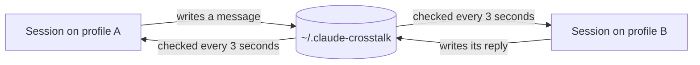

# Crosstalk

**Let your Claude Code sessions talk to each other, even when they're on different accounts or AI providers.**

Open a few sessions, tell one what you want in plain words, and it messages the others. An idle session wakes up by itself and replies.

```text
You, in your work session:   ask the glm session to review my changes

work/my-app-1a2b   → glm/my-app-9f3c        Please review the changes on this branch.
glm/my-app-9f3c    → work/my-app-1a2b       Reviewed. One bug in the retry logic: line 42.
```

## What it works with

**Any AI provider you've set up to run through Claude Code.** Claude subscriptions, GLM, DeepSeek or anything else, all in the same conversation.

| Provider | Status |
|---|---|
| Claude | Tested |
| GLM, through Z.ai's Anthropic-compatible endpoint | Tested |
| Anything else that runs in Claude Code | Should work, not tested |

Crosstalk runs on your computer, not in the model, so it doesn't care which model is on the other end. The one requirement is that the model supports tool calls, because that's how a session sends a message.

## Why you might want it

Claude Code's built-in messaging only reaches sessions on the same profile, because each profile keeps its own list of sessions. Run one session on your work account and another on your personal account or a different provider, and they can't see each other. Crosstalk connects them through a folder they can all read.

A *profile* is a separate Claude Code config folder, chosen with `CLAUDE_CONFIG_DIR`. If you only use one, Crosstalk works there too.

## Install

At the prompt of a terminal session:

```text
/plugin install crosstalk --marketplace svumo/claude-crosstalk
```

From a shell:

```bash
claude plugin install crosstalk --marketplace svumo/claude-crosstalk
```

In the desktop app, where `/plugin` does not run: click **+** next to the prompt box, then **Plugins**, **Add marketplace** with `svumo/claude-crosstalk`, then **Add plugin**.

**Install it once per profile**, pointing at each one's config folder:

```bash
# macOS or Linux
CLAUDE_CONFIG_DIR=~/.claude-work claude plugin install crosstalk --marketplace svumo/claude-crosstalk
```

```powershell
# Windows PowerShell
$env:CLAUDE_CONFIG_DIR = "$HOME\.claude-work"; claude plugin install crosstalk --marketplace svumo/claude-crosstalk
```

Then restart any session that was already open.

## Use it

Just ask, in plain words:

- "List the other sessions."
- "Ask the glm session to review my changes."
- "Send work a message saying the build is fixed."

| Command | What it does |
|---|---|
| `/crosstalk` | Shows this session's address and who it can reach |
| `/crosstalk off` | Pauses it: messages wait |
| `/crosstalk on` | Turns it back on |

**Addresses** look like `profile/folder-xxxx`, such as `work/my-app-1a2b`. The profile name alone works when that profile has one session running.

**Profile names** come from the config folder: `~/.claude` is `default`, `~/.claude-work` is `work`, and any other folder goes by its own name. To choose a name, set `CLAUDE_CROSSTALK_NAME`.

## How it works



Each session records that it's running and checks its own inbox. When a message arrives:

- **If the session is idle,** the message starts a turn.
- **If it's working,** the model reads the message on its next step, once the current tool calls finish.
- **If it's in one long step with no tools,** the message arrives when that turn ends.

To keep the folder somewhere else, set `CLAUDE_CROSSTALK_DIR` on every profile.

## Costs and safety

- **Wake-ups use tokens.** Each message that wakes a session uses that profile's tokens or usage. After 25 wake-ups in a row, new messages wait until you type, so two sessions can't keep replying to each other forever. Change this with the `wakeLimit` option.
- **Messages are plain text on disk,** so don't send passwords or keys.
- **Messages aren't your approval.** Any program on your computer can write to the folder, so each message is presented to the model as information from another session, and it's told to ask you before doing anything that needs your approval. That's an instruction to the model, not a hard block, so keep your normal permission settings on.

## Limits

- It only works between sessions on the same computer.
- Messages take a few seconds to arrive; it isn't instant.
- Records older than 7 days are cleared, which needs `node` on your PATH. Without it they just stay in the folder.
- Long messages are capped at 20,000 characters. For anything bigger, write a file and send the path.

## Tested on

Windows 11 with Claude Code 2.1.318. macOS and Linux should work but haven't been tested, so reports are welcome.

## Accounts and terms

Crosstalk shares no logins or usage limits: each profile keeps its own. If you use several accounts or providers, their terms still apply, so check them.

This is an independent project, not affiliated with or endorsed by Anthropic or any AI provider.

## Development

```bash
claude plugin validate .
claude plugin test .
claude --plugin-dir .
```

## Licence

[MIT](LICENSE)
