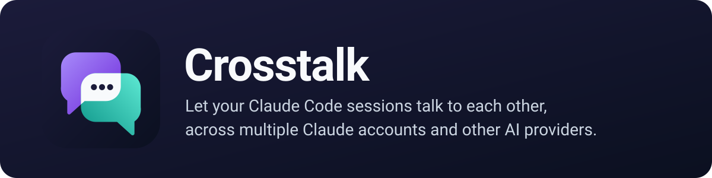
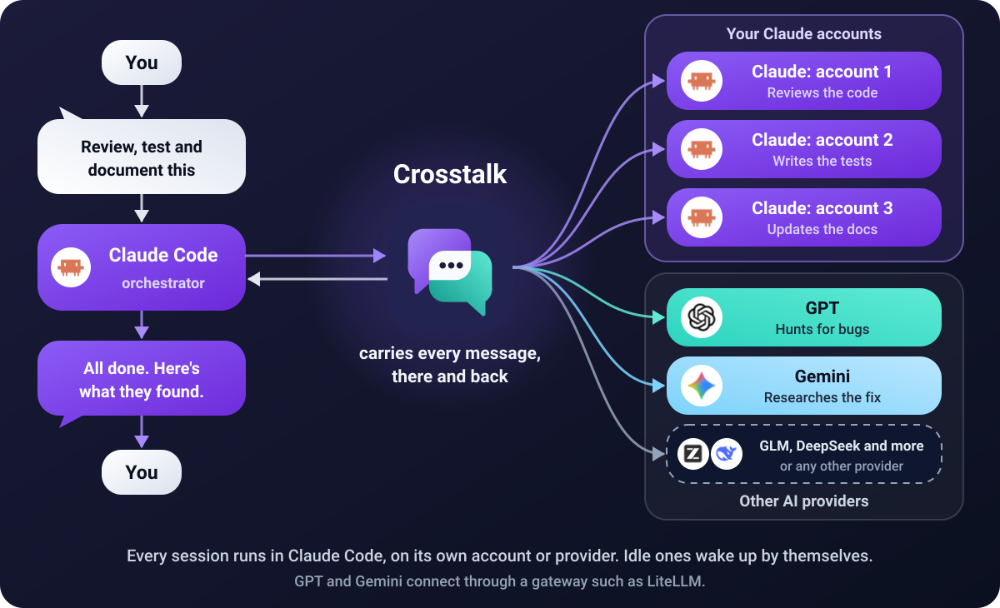
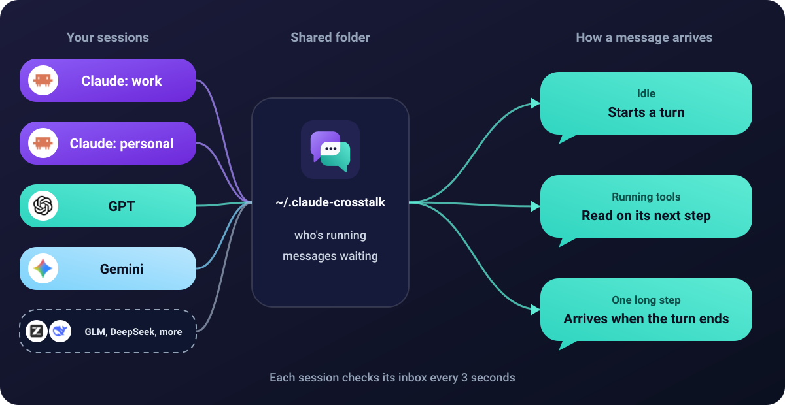

<p align="center">
  
</p>

<p align="center">
  <a href="#install"></a>
  <a href="#what-it-works-with"></a>
  <a href="LICENSE"></a>
</p>

<p align="center">
  <b>Tell one session what you want. It hands the work to your other sessions, and they reply when they're done.</b><br>
  Idle sessions wake up by themselves, on any account and any provider.
</p>

<p align="center">
  
</p>

<p align="center">
  <a href="#install">Install</a> ·
  <a href="#use-it">Use it</a> ·
  <a href="#multiple-claude-accounts">Multiple accounts</a> ·
  <a href="#what-it-works-with">Providers</a> ·
  <a href="#how-it-works">How it works</a> ·
  <a href="#costs-and-safety">Costs and safety</a>
</p>

## Install

**1. Install it.** At the prompt of a terminal session, then restart that session:

```text
/plugin install crosstalk --marketplace svumo/claude-crosstalk
```

**2. Connect your other profiles.** Skip this if you only have one.

```text
/crosstalk setup
```

It lists the profiles it found and what it would do, without changing anything. If that looks right:

```text
/crosstalk setup yes
```

That installs Crosstalk on each profile and gives any profile with no way to start it a short command, such as `claude-work`. Open a new terminal, start your sessions, and they can reach each other.

Don't have a second profile yet? `/crosstalk add work` makes one. Run `claude-work` in a new terminal and log in.

<details>
<summary><b>From a shell, or the desktop app</b></summary>

From a shell:

```bash
claude plugin install crosstalk --marketplace svumo/claude-crosstalk
```

In the desktop app, where `/plugin` does not run: click **+** next to the prompt box, then **Plugins**, **Add marketplace** with `svumo/claude-crosstalk`, then **Add plugin**.

</details>

## Use it

Just ask, in plain words:

- "List the other sessions."
- "Ask the session on my second account to review my changes."
- "Send work a message saying the build is fixed."

| Command | What it does |
|---|---|
| `/crosstalk` | Shows this session's address and who it can reach |
| `/crosstalk off` | Pauses it: messages wait |
| `/crosstalk on` | Turns it back on |
| `/crosstalk setup` | Shows your profiles and what setup would do. Changes nothing |
| `/crosstalk setup yes` | Does it |
| `/crosstalk add <name>` | Makes a new profile, ready to log in to |
| `/crosstalk open <profile> [message]` | Starts a session on that profile in a new terminal, in this folder, and sends it your message once it's up |
| `/crosstalk open-in auto\|vscode\|window` | Where `open` starts it. `auto` is a VS Code terminal when you're in VS Code, else a new window |
| `/crosstalk launch <profile> <command>` | The command that starts a profile, such as `claude zai`. Default: `claude-<profile>` |

Every message that arrives is also shown to you in the transcript, as `Crosstalk ← sender`, so you don't have to ask whether anyone replied.

### Opening a session in VS Code

`/crosstalk open` opens a new terminal tab in your VS Code window, and the model can do the same: "Open a GLM session and ask it to review this file." This needs a small helper extension, because nothing outside VS Code can open a terminal inside it. Install it once:

```bash
code --install-extension <the plugin's folder>/vscode/crosstalk-terminal-0.1.0.vsix
```

Or build it from `vscode/` with `npx @vscode/vsce package`. The helper only runs commands that start Claude Code, so a link from anywhere else can't run anything else through it. Without the helper, or outside VS Code, `open` starts a new Windows Terminal window. Other systems are not supported yet.

If you start a profile some other way than `claude-<profile>`, tell Crosstalk once: `/crosstalk launch zai claude zai`.

**Addresses** look like `profile/folder-xxxx`, such as `work/my-app-1a2b`. The profile name alone works when that profile has one session running.

Crosstalk carries the messages; it doesn't plan the work. Whichever session you ask does the orchestrating, so you can make any session the lead.

## Multiple Claude accounts

Claude Code's built-in messaging only reaches sessions on the same profile, because each profile keeps its own list of sessions. A session on one account can't see a session on another. Crosstalk connects them through a folder they can all read.

A *profile* is a separate Claude Code config folder with its own login, so each account gets its own.

**Everyone sets these up differently, so setup looks in several places:**

- this session's own profile
- `.claude` and `.claude-*` folders in your home folder
- any `CLAUDE_CONFIG_DIR` in your PowerShell profile, `.bashrc`, `.zshrc` and similar, which is how it finds folders kept somewhere else
- folders you've told it about

If you already start a profile your own way, it leaves that alone and adds no shortcut. If the list isn't right, correct it:

| Command | What it does |
|---|---|
| `/crosstalk setup add <folder> [name]` | Adds a profile it missed. Put a path with spaces in double quotes |
| `/crosstalk setup skip <name>` | Leaves one out, such as an old backup |
| `/crosstalk setup name <name> <new name>` | Changes a profile's name |

**Names** come from the folder unless you change them: `~/.claude` is `default`, `~/.claude-work` is `work`, and any other folder goes by its own name.

<details>
<summary><b>What setup changes on your computer</b></summary>

- It runs `claude plugin install` for each profile that needs it.
- It adds shortcuts to your PowerShell profile, and your `.bashrc` or `.zshrc`, inside a marked `crosstalk shortcuts` block. Running it again updates that block and nothing else. The file as it was is saved beside it, ending `.crosstalk-backup`.
- From your shell files it only takes folder paths, and from a profile's settings only the provider's host name. It doesn't copy or show keys.

If PowerShell isn't allowed to run its profile, setup tells you the command to allow it and doesn't write the file. If an install fails, it gives you the line to run yourself.

</details>

<details>
<summary><b>Doing it by hand</b></summary>

```bash
# macOS or Linux
CLAUDE_CONFIG_DIR=~/.claude-work claude plugin install crosstalk --marketplace svumo/claude-crosstalk
CLAUDE_CONFIG_DIR=~/.claude-work claude
```

```powershell
# Windows PowerShell
$env:CLAUDE_CONFIG_DIR = "$HOME\.claude-work"
claude plugin install crosstalk --marketplace svumo/claude-crosstalk
claude
```

</details>

## What it works with

**Any AI provider you can point Claude Code at.** Claude Code speaks Anthropic's API format, so that means anything with an Anthropic-compatible endpoint, or any other model through a translating gateway such as LiteLLM. The model has to support tool calls, because that's how a session sends a message.

| Provider | How it connects | Status |
|---|---|---|
| Claude, on one or many accounts | Directly | Tested |
| GPT | Through a gateway such as LiteLLM | Should work, not tested |
| Gemini | Through a gateway such as LiteLLM | Should work, not tested |
| Others: GLM, DeepSeek and more | Their Anthropic-compatible endpoint, or a gateway | GLM tested, the rest should work |

Crosstalk runs on your computer, not in the model, so it doesn't care which model is on the other end. If you try a provider that isn't marked as tested, reports are welcome.

<details>
<summary><b>Adding a provider</b></summary>

Make a profile for it with `/crosstalk add glm`, then put the provider's details in that profile's `settings.json`, here `~/.claude-glm/settings.json`:

```json
{
  "env": {
    "ANTHROPIC_BASE_URL": "https://api.z.ai/api/anthropic",
    "ANTHROPIC_AUTH_TOKEN": "your key"
  }
}
```

That's Z.ai's endpoint for GLM. For another provider, use its own Anthropic-compatible address, or your gateway's. Start it with `claude-glm`, then run `/crosstalk setup` from any profile: the provider shows beside the name.

</details>

## How it works

<p align="center">
  
</p>

Each session records that it's running and checks its own inbox. When a message arrives:

- **If the session is idle,** the message starts a turn.
- **If it's working,** the model reads the message on its next step, once the current tool calls finish.
- **If it's in one long step with no tools,** the message arrives when that turn ends.

## Costs and safety

- **Wake-ups use tokens.** Each message that wakes a session uses that profile's tokens or usage. After 25 wake-ups in a row, new messages wait until you type, so two sessions can't keep replying to each other forever. To change the number, set `CLAUDE_CROSSTALK_WAKE_LIMIT`.
- **Messages are plain text on disk,** so don't send passwords or keys.
- **Messages aren't your approval.** Any program on your computer can write to the folder, so each message is presented to the model as information from another session, and it's told to ask you before doing anything that needs your approval. That's an instruction to the model, not a hard block, so keep your normal permission settings on.

## Limits

- It only works between sessions on the same computer.
- Messages take a few seconds to arrive; it isn't instant.
- Records older than 7 days are cleared, which needs `node` on your PATH. Without it they just stay in the folder.
- Messages are capped at 20,000 characters. For anything bigger, write a file and send the path.

## Troubleshooting

| What you see | What to do |
|---|---|
| `claude-work` isn't recognised | Open a new terminal, as shortcuts load when one starts. In PowerShell, setup says if scripts need allowing. |
| A session isn't listed | Restart it, as sessions only load the plugin when they start. `/crosstalk setup` shows if it's installed on that profile. |
| Install says "Host key verification failed" on Windows | The profile's folder path may be too long. In testing, installs failed from 140 characters, so use a shorter folder. |
| A profile isn't in `/crosstalk setup` | Add it with `/crosstalk setup add <folder>`. |
| "could be several sessions" | That profile has more than one session running, so use the whole address. |
| Two profiles show the same name | Change one with `/crosstalk setup name`. |
| A message didn't wake a session | Run `/crosstalk` there. It may be off, or at its wake-up limit, which clears when you type. |
| A provider can't send messages | Its model may not support tool calls. |
| `open` makes a window, not a VS Code tab | The helper isn't installed (see Opening a session in VS Code), or `open-in` is set to `window`. |
| `open` says no session showed up | Look in the new terminal. The launch command may be wrong: check it with `/crosstalk launch <profile>`. |
| With several VS Code windows, the tab opened in another one | The link goes to the window you used last. Click into the one you want, then try again. |

## Settings

Optional environment variables, set before you start a session:

| Variable | What it does | Default |
|---|---|---|
| `CLAUDE_CROSSTALK_NAME` | This session's profile name, over any other | From the folder |
| `CLAUDE_CROSSTALK_DIR` | The shared folder. Set the same on every profile | `~/.claude-crosstalk` |
| `CLAUDE_CROSSTALK_WAKE_LIMIT` | Wake-ups in a row before messages wait for you | 25 |
| `CLAUDE_CROSSTALK_OPEN_IN` | Where `/crosstalk open` starts a session (`auto`, `vscode`, `window`), over the saved setting | `auto` |

`/crosstalk open-in` and `/crosstalk launch` save their settings in `setup.json` in the shared folder, so every profile uses them.

## Tested on

Windows 11 with Claude Code 2.1.318, using PowerShell 7 and Git Bash. macOS, Linux and zsh should work but haven't been run for real, so reports are welcome.

## Accounts and terms

Crosstalk shares no logins or usage limits: each profile keeps its own. If you use several accounts or providers, their terms still apply, so check them.

This is an independent project, not affiliated with or endorsed by Anthropic, OpenAI, Google, Z.ai, DeepSeek or any other AI provider. Their names and logos belong to them and are used only to show what Crosstalk can connect to.

## Development

```bash
claude plugin validate .
claude plugin test .
claude --plugin-dir .
```

To try `/crosstalk setup` without touching your real shell files or profiles, set `CLAUDE_CROSSTALK_HOME` to an empty folder, which stands in for your home folder. `CLAUDE_CROSSTALK_MARKETPLACE` changes where it installs from.

## Licence

[MIT](LICENSE)
